<h1 align="center">powietrze-mcp 🌫️</h1>

<p align="center">
  <b>Jakość powietrza, smog i pyłki w Polsce – dla Twojego asystenta AI.</b><br>
  Serwer <a href="https://modelcontextprotocol.io">MCP</a> z bieżącymi pomiarami państwowych stacji GIOŚ, indeksem jakości powietrza, ostrzeżeniami smogowymi i prognozą CAMS (Copernicus) na 3 dni. Działa w Claude, ChatGPT, Cursorze i każdym kliencie MCP.
</p>

<p align="center">
  <a href="https://www.npmjs.com/package/powietrze-mcp"></a>
  <a href="https://github.com/ContentWriterco/powietrze-mcp/actions/workflows/ci.yml"></a>
  <a href="LICENSE"></a>
  
</p>

<p align="center">
  
</p>
<p align="center"><sub>Prawdziwa odpowiedź publicznego serwera (22.10.2026, 22:00).</sub></p>

## Podłącz w 30 sekund

Adres MCP: **`https://powietrze.compabase.com/mcp`** (Streamable HTTP, bez logowania).

- **Claude:** Ustawienia → Connectors → *Add custom connector* → wklej adres.
- **ChatGPT:** Settings → Connectors (tryb deweloperski) → dodaj serwer MCP.
- **Claude Code:** `claude mcp add --transport http powietrze https://powietrze.compabase.com/mcp`
- **Lokalnie (stdio):** `npx -y powietrze-mcp`, np. w Claude Desktop:

```json
{ "mcpServers": { "powietrze": { "command": "npx", "args": ["-y", "powietrze-mcp"] } } }
```

## Co potrafi

| Narzędzie | Do czego |
|---|---|
| `air_quality` | Dla miejscowości, adresu albo współrzędnych: najbliższe stacje GIOŚ (do 25 km) z **indeksem jakości powietrza** (bardzo dobry … bardzo zły), ostatnimi pomiarami **PM2.5, PM10, NO2, O3, SO2**, średnią dobową pyłów i odniesieniem do norm; **ostrzeżenia smogowe** GIOŚ w województwie; **prognoza na 3 dni** z modelu Copernicus CAMS – maksymalne PM2.5/PM10, europejski indeks jakości powietrza i **pyłki** (brzoza, olsza, trawy, bylica, ambrozja). |
| `air_stations` | Stacje pomiarowe GIOŚ w mieście, gminie, powiecie albo województwie. |
| `data_sources` | Źródła i zastrzeżenia. |

**Przykładowe pytania:** „Czy mogę dziś pobiegać w Krakowie?”, „Jaki jest smog w Zakopanem i czy jutro będzie lepiej?”, „Czy w weekend będzie dużo pyłków brzozy w Warszawie?”, „Jaka jest jakość powietrza przy ul. Marszałkowskiej 1 w Warszawie?”.

## Skąd dane

- **Pomiary:** Główny Inspektorat Ochrony Środowiska – Państwowy Monitoring Środowiska, API `https://api.gios.gov.pl/pjp-api` (ok. 290 stacji, wartości godzinowe; dane bieżące są niezweryfikowane). Odpowiedzi trzymamy w pamięci podręcznej (lista stacji 12 h, pomiary i indeks 15 min), żeby nie obciążać GIOŚ.
- **Prognoza i pyłki:** Copernicus Atmosphere Monitoring Service (CAMS) przez Open-Meteo (CC BY 4.0) – model w siatce ok. 10 km, nie zastępuje pomiaru. Można wyłączyć: `POWIETRZE_FORECAST=0`.
- **Adresy:** GUGiK (państwowy rejestr adresów).

## Własny serwer

```bash
npx -y powietrze-mcp --http --port 3000      # MCP: http://localhost:3000/mcp
npx -y powietrze-mcp now "Kraków, Rynek Główny 1"
npx -y powietrze-mcp stations "małopolskie"
```

Zmienne: `POWIETRZE_FORECAST=0`, `POWIETRZE_RATE_LIMIT`, `POWIETRZE_STATS=1` (anonimowe liczniki pod `/stats`), `POWIETRZE_CONTACT`, `POWIETRZE_PUBLIC_URL`.

## Licencja

Kod: MIT. Dane: GIOŚ (Państwowy Monitoring Środowiska), Copernicus CAMS / Open-Meteo (CC BY 4.0), GUGiK – dane przetworzone. Projekt niezależny, hostowany pro publico bono przez [Compabase](https://compabase.com). Zobacz też [rozkład-mcp](https://github.com/ContentWriterco/rozklad-mcp), [ceny-nieruchomosci-mcp](https://github.com/ContentWriterco/ceny-nieruchomosci-mcp) i [leki-mcp](https://github.com/ContentWriterco/leki-mcp).

---

## English

<p align="center"></p>

**powietrze-mcp** gives AI assistants **live air quality in Poland**: the nearest official GIOŚ monitoring stations with the Polish air quality index and the latest hourly PM2.5, PM10, NO2, O3 and SO2, smog warnings for the voivodeship, and a **3-day Copernicus CAMS forecast** of particulate matter and **pollen** (birch, alder, grass, mugwort, ragweed). Public endpoint: `https://powietrze.compabase.com/mcp` (no key), or run locally with `npx -y powietrze-mcp`.
